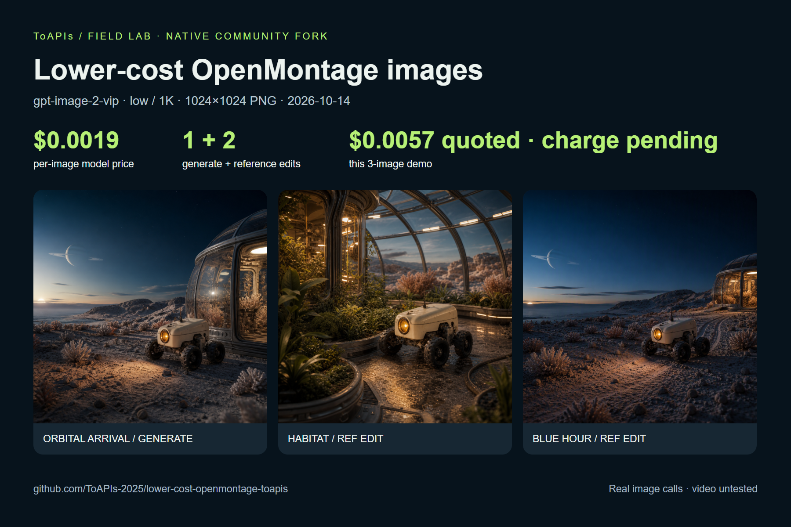
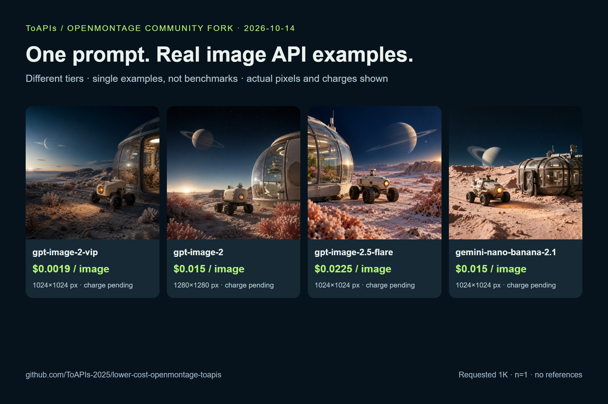
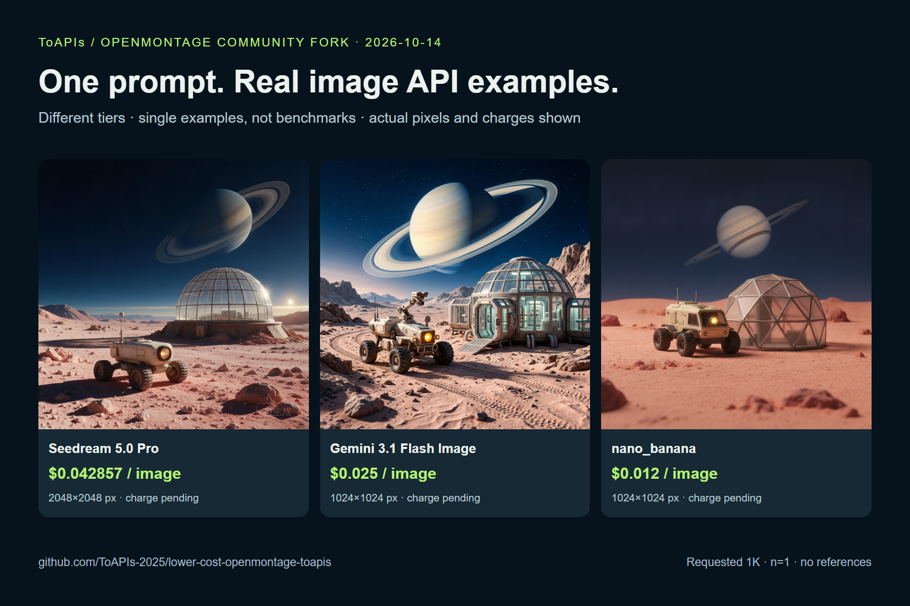

# Lower-cost OpenMontage image provider

[简体中文](README_zh-CN.md) · [Model pricing & API access](https://go2v.toapis.com/om14ge) · [Original OpenMontage](https://github.com/calesthio/OpenMontage)

**$0.0019/image** for ToAPIs `gpt-image-2-vip`, `low / 1K / n=1`. Generate an original orbital rover scene, then two reference-guided storyboard variations through a native OpenMontage `BaseTool`. 3 calls quoted at **$0.0057 total**; API billing is null, settled charges pending confirmation.

## Demo



| Scene | Operation | Actual output | Download |
|---|---|---|---|
| orbital-arrival | Text-to-image | 1024×1024 PNG | [Image](examples/toapis/results/orbital-arrival/result.png) · [Evidence](examples/toapis/results/orbital-arrival/evidence.json) |
| habitat-interior | Reference-guided edit | 1024×1024 PNG | [Image](examples/toapis/results/habitat-interior/result.png) · [Evidence](examples/toapis/results/habitat-interior/evidence.json) |
| blue-hour-departure | Reference-guided edit | 1024×1024 PNG | [Image](examples/toapis/results/blue-hour-departure/result.png) · [Evidence](examples/toapis/results/blue-hour-departure/evidence.json) |

Original prompts: [cases.json](examples/toapis/cases.json). Actual calls dated 2026-10-14. Model generations are stochastic; the recipe is repeatable, pixel-identical output is not promised.

## Seven model options: real examples, prices and charges

All 11 calls quoted at **$0.195914 total**. API billing is null; settled charges await backend confirmation.





| Model / API route | Tier | Quote / image | Actual charge / sample | Actual px | Client seconds | Output |
|---|---|---|---|---|---|---|
| [`gpt-image-2-vip`](https://go2v.toapis.com/om14ge) | low / requested 1K | $0.0019 | 待后台确认 / pending | 1024×1024 / PNG | not recorded / recovered | [PNG](examples/toapis/results/orbital-arrival/result.png) · [record](examples/toapis/results/orbital-arrival/evidence.json) |
| [`gpt-image-2`](https://toapis.com/en/model-guide/gpt-image-2?utm_campaign=om14i2) | — / requested 1K | $0.015 | 待后台确认 / pending | 1280×1280 / PNG | 115.69 | [PNG](examples/toapis/resolution-probes/gpt-image-2/result.png) · [record](examples/toapis/resolution-probes/gpt-image-2/evidence.json) |
| [`gpt-image-2.5-flare`](https://im25.toapis.com/om14f) | high / requested 1K | $0.0225 | 待后台确认 / pending | 1024×1024 / PNG | 60.2 | [PNG](examples/toapis/comparison/gpt-image-2.5-flare/result.png) · [record](examples/toapis/comparison/gpt-image-2.5-flare/evidence.json) |
| [`gemini-nano-banana-2.1`](https://toapis.com/en/model-guide/gemini-nano-banana-2-1?utm_campaign=om14n1) | — / requested 1K | $0.015 | 待后台确认 / pending | 1024×1024 / JPEG → PNG | 32.38 | [PNG](examples/toapis/comparison/gemini-nano-banana-2.1/result.png) · [Original JPEG](examples/toapis/comparison/gemini-nano-banana-2.1/result-original.jpg) · [record](examples/toapis/comparison/gemini-nano-banana-2.1/evidence.json) |
| [`doubao-seedream-5-0-pro`](https://toapis.com/en/model-guide/doubao-seedream-5-0-pro?utm_campaign=om14s5) | medium (quote) / requested 1K | $0.042857 | 待后台确认 / pending | 2048×2048 / JPEG → PNG | 86.95 | [PNG](examples/toapis/resolution-probes/doubao-seedream-5-0-pro/result.png) · [Original JPEG](examples/toapis/resolution-probes/doubao-seedream-5-0-pro/result-original.jpg) · [record](examples/toapis/resolution-probes/doubao-seedream-5-0-pro/evidence.json) |
| [`gemini-3.1-flash-image-preview`](https://nano2.toapis.com/om14n2) | — / requested 1K | $0.025 | 待后台确认 / pending | 1024×1024 / PNG | 32.77 | [PNG](examples/toapis/comparison/gemini-3.1-flash-image-preview/result.png) · [record](examples/toapis/comparison/gemini-3.1-flash-image-preview/evidence.json) |
| [`nano_banana`](https://x.toapis.com/om14nb) | — / requested 1K | $0.012 | 待后台确认 / pending | 1024×1024 / PNG | 14.41 | [PNG](examples/toapis/comparison/nano_banana/result.png) · [record](examples/toapis/comparison/nano_banana/evidence.json) |

[Full comparison, resolution audit and reproduction commands](examples/toapis/MODEL_COMPARISON.md). Same prompt, different quality tiers; single examples are not a performance ranking.

## API pricing and this demo's spend

| Model | Tier | Current price | This demo |
|---|---|---|---|
| `gpt-image-2-vip` | `low / 1K / n=1` | **$0.0019/image** | $0.0057 / 3 calls quoted, charge pending |

The VIP storyboard tier below and the tested alternatives in the comparison are priced here. Quote checked 2026-10-14 through the authenticated pricing API. 1 credit = $0.005. Original API `billing: null` is preserved in the sanitized evidence; settled charges come from the account owner's backend confirmation when available. [Price snapshot](examples/toapis/pricing.json).

## Reproduce

Python 3.10+. The full upstream source remains in this real fork. For this single image tool, the small dependency list below is sufficient. Full studio use follows the upstream requirements and [AGENT_GUIDE](AGENT_GUIDE.md).

```bash
git clone --depth 1 https://github.com/ToAPIs-2025/lower-cost-openmontage-toapis.git
cd lower-cost-openmontage-toapis
python -m pip install -r requirements-toapis.txt
python examples/toapis/demo.py
# Configure TOAPIS_API_KEY privately, then run the charged demo:
python examples/toapis/demo.py --live
python -m unittest discover -s tests/tools -p test_toapis_image.py
```

`TOAPIS_BASE_URL` defaults to **https://toapis.com**; https://toapis.cn and a trailing /v1 are accepted. No OpenAI or fal key is needed for this provider. `.env.example` includes the new variables; keep keys and `.toapis-state` private. The CLI is a native-provider smoke test, not a complete video production run.

## Native integration

New [ToAPIsImage](tools/graphics/toapis_image.py) is discovered by the upstream registry as `toapis_image`, provider `toapis`. It preserves the existing OpenAI route and uses a separate [async adapter](tools/toapis_async.py).

```python
from tools.graphics.toapis_image import ToAPIsImage
result = ToAPIsImage().execute({
    "prompt": "An original ivory exploration rover on a coral desert moon",
    "model": "gpt-image-2-vip", "quality": "low", "resolution": "1K",
    "size": "1024x1024", "n": 1,
    "output_path": "projects/my-story/assets/images/rover.png",
    "run_id": "my-rover-v1"
})
```

For `image_selector`, require `preferred_tool="toapis_image"`, `hosting_provider="toapis"` and the exact model. Registration and exact route filtering were tested; full automatic agent routing was not. Follow the [tool contract](docs/TOAPIS.md).

## What's changed and tested

- Bearer auth to /v1; authenticated pricing lookup; ratio/resolution mapping; local reference upload; one generation submission; task polling; PNG download and saving.
- Durable task receipts resume an existing task, and block another POST after an ambiguous submission. Change run_id explicitly to request a new generation.
- Fixed a real CDN download failure: Python's default User-Agent returned Cloudflare 1010/403. Result downloads use an accepted User-Agent and carry no API key. The first task was recovered without resubmission.
- Ten offline native tests passed; eleven real `ToolRegistry` + `ToAPIsImage.execute` calls succeeded. Masks, transparency, multiple outputs, non-VIP reference edits and untested tiers fail before submission.

Video, audio, Backlot UI, the complete agent production pipeline and visual continuity are not validated by these image tests. Reference edits can change details; inspect the actual images.

## Upstream attribution

Community fork of [calesthio/OpenMontage](https://github.com/calesthio/OpenMontage), pinned at `e45f5b12bd46440b04f3675af9a77d0718e6a254`. Original [English README](README_UPSTREAM.md), [Chinese README](README_UPSTREAM_zh-CN.md), all source, license and sponsor links remain. The project remains [AGPL-3.0](LICENSE); the reused standalone adapter has its [MIT notice](tools/TOAPIS_ADAPTER_LICENSE). No upstream partnership or endorsement is claimed.

Original JPEGs are retained; PNG convenience copies are serialized locally. The explicit resolution probes still returned 1280×1280 for standard GPT and 2048×2048 for Seedream. Requested 1K does not imply a 1024px result.
