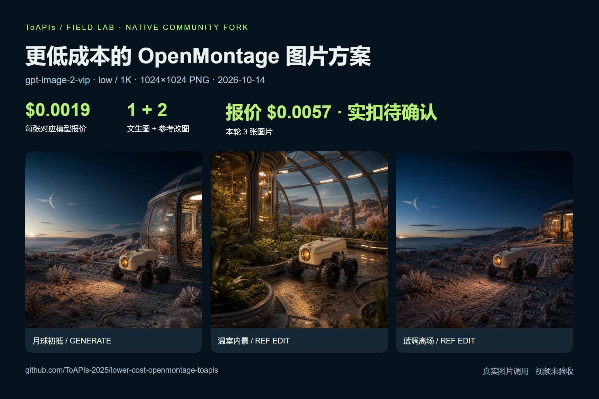
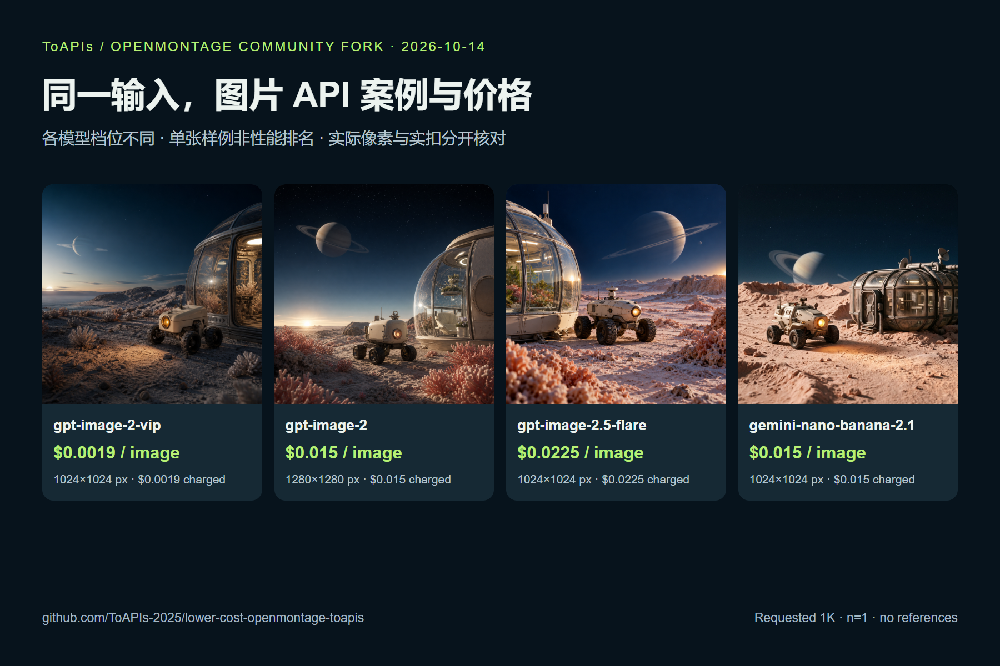
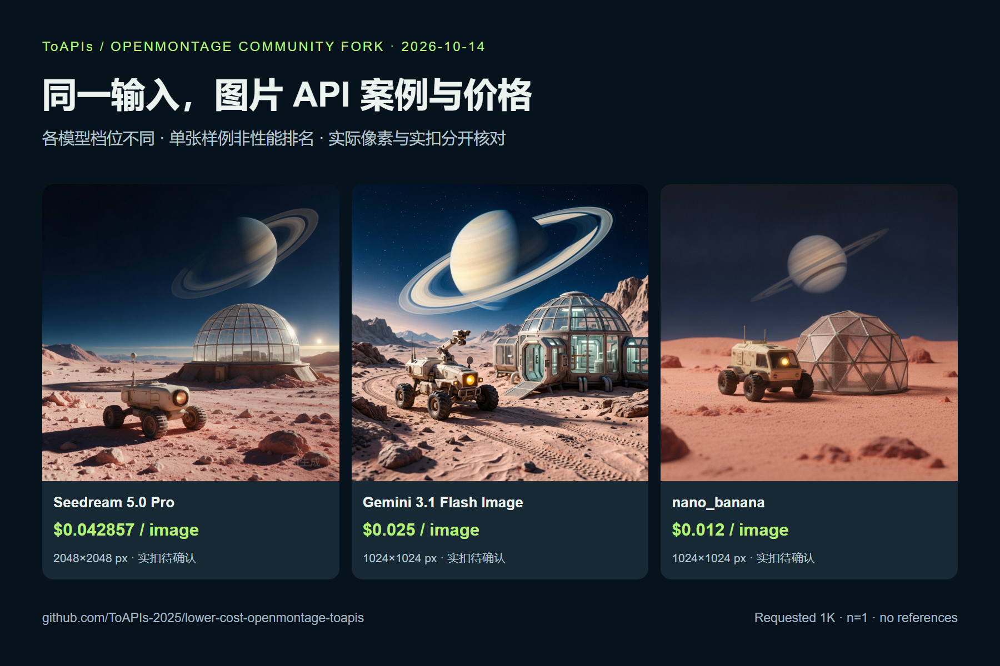

# 更低成本的 OpenMontage 图片方案


<!-- TOAPIS-MODELS-20261020 -->
## 模型与价格更新 · 2026-10-20

新增可独立运行的31套图片请求模板、8套视频模板。当前26套图片与8套视频可匹配同Key精确价格；另5套图片缺价，默认阻止新付费调用。它们属于额外API脚本；项目原生Provider、UI、导入及完整出片的验收范围仍以下方原教程为准。

| 图片模型／实测档位 | 当前档位报价／张 | 历史案例金额／张 | 费用证据 |
|---|---:|---:|---|
| gpt-image-2(VIP)<br><sub>low</sub> | $0.0019/image | **$0.0019/image** | 计费日志，阶段未知 |
| gpt-image-2.5-flare-vip<br><sub>low</sub> | 当前Key暂未返回报价 | **$0.005272/image**<br><sub>Token计费；当前$/M未返回，本例金额不是固定单张价。</sub> | 任务回执已结算 |
| nano_banana<br><sub>1K</sub> | $0.012/image | **$0.012/image** | 计费日志，阶段未知 |
| gemini-nano-banana-2.1<br><sub>1K</sub> | $0.015/image | **$0.015/image** | 计费日志，阶段未知 |
| gpt-image-2<br><sub>1K</sub> | $0.015/image | **$0.015/image** | 计费日志，阶段未知 |
| gemini-nano-banana-2.1-vip<br><sub>1K</sub> | $0.02/image | **$0.02/image** | 计费日志，阶段未知 |
| qwen-image-3.0<br><sub>1K</sub> | 当前Key暂未返回报价 | **$0.021/image** | 计费日志，阶段未知 |
| gpt-image-2.5-flare<br><sub>high</sub> | $0.0225/image | **$0.0225/image** | 计费日志，阶段未知 |
| gpt-image-2.5-sunburst<br><sub>high</sub> | $0.0225/image | **$0.0225/image** | 计费日志，阶段未知 |
| flux-2-pro<br><sub>1K</sub> | $0.025/image | **$0.025/image** | 计费日志，阶段未知 |
| doubao-seedream-5-0-pro<br><sub>1K</sub> | $0.042857/image | **$0.042856/image** | 计费日志，阶段未知 |

| 视频模型 | 档位／输入 | 本例消费 | 文件时长 | 本例每秒金额（升序） |
|---|---|---:|---:|---|
| MiniMax-H3-Max-Turbo | 5s / 480P / 文生视频 | $0.125/clip | 5.18s | **$0.024131/s**<br><sub>pricing底层费率：$0.025/s</sub> |
| seedance-2-mini | 4s / 480p / 首帧 | $0.13338/clip | 4.04s | **$0.033015/s**<br><sub>pricing底层费率：$3.285714/M total tokens</sub> |
| seedance-2-fast | 4s / 480p / 文生视频 | $0.214568/clip | 4.04s | **$0.053111/s**<br><sub>pricing底层费率：$5.285714/M total tokens</sub> |
| kling-v3 | 5s / 720p / std / 文生视频 | $0.3/clip | 5.04s | **$0.059524/s**<br><sub>pricing底层费率：$0.06/s</sub> |
| MiniMax-H3 | 5s / 768p / 文生视频 | $0.32/clip | 5.17s | **$0.061896/s**<br><sub>pricing底层费率：$0.064/s</sub> |
| seedance-2 | 4s / 480p / 首帧 | $0.26676/clip | 4.04s | **$0.06603/s**<br><sub>pricing底层费率：$6.571429/M total tokens</sub> |
| kling-3.0-turbo | 4s / 720p / 文生视频 | $0.32/clip | 4.04s | **$0.079208/s**<br><sub>pricing底层费率：$0.08/s</sub> |
| seedance-2-5 | 4s / 480p / 文生视频 | $0.3883/clip | 4.04s | **$0.096114/s**<br><sub>pricing底层费率：$10/M total tokens</sub> |

报价核对：2026-10-20。图片案例日期2026-10-17；视频案例日期2026-10-20。表格按本例金额／秒金额排序，质量、分辨率和输入不同，不是同配置质量排名。图片日志的阶段未知，不能当作单任务最终净结算；当前报价与历史金额分别显示。视频金额均由billing=settled确认，$/s按实际文件时长折算，任务处理耗时不参与计算。Token模型不是固定每秒价，底层$/M只作小字补充。

gpt-image-2(VIP)通用价格为$0.0019/image起；本例low/1K为$0.0019/image。新脚本有31套历史成功图片请求模板、8套视频模板；当前26套图片与8套视频可匹配价格，另5套图片因当前Key缺价而默认阻止新付费调用。

[本仓库多模型脚本](toapis-models/README_zh-CN.md) · [完整价表](PRICING_zh-CN.md) · [原图／视频及费用证据](https://github.com/ToAPIs-2025/toapis-quickstart/tree/main/tutorials/model-support-2026-10-20)

下方保留原项目历史案例、消费及集成说明；历史金额不改成今天的新报价。

<!-- /TOAPIS-MODELS-20261020 -->

<!-- TOAPIS-MODEL-COST-UPDATE-20261016 -->
## 模型类型、测试档位与花费

更新：2026-10-16。下表为已验证案例的历史档位与价格；本段补充不改变下方原批次记录。

| 模型（API ID） | 类型 | 测试档位 | 单次报价 | 已确认单次消费 | 数量 |
|---|---|---|---:|---:|---:|
| gpt-image-2(VIP) (`gpt-image-2-vip`) | 图片 | low / 1K / n=1 | $0.0019/image | $0.0019 | 3 |
| nano_banana | 图片 | 1K | $0.012/image | $0.012 | 1 |
| gpt-image-2 | 图片 | 1K / n=1 | $0.015/image | $0.015 | 2 |
| Nano Banana 2.1 (`gemini-nano-banana-2.1`) | 图片 | 1K / n=1 | $0.015/image | $0.015 | 1 |
| gpt-image-2.5-flare | 图片 | high / 1K / n=1 | $0.0225/image | $0.0225 | 1 |
| gemini-3.1-flash-image-preview | 图片 | 1K | $0.025/image | $0.025 | 1 |
| doubao-seedream-5-0-pro | 图片 | medium quoted / requested 1K | $0.042857/image | $0.042856 | 2 |

原图片/视频案例已核对消费小计：**$0.195912**。

BaseTool注册和图片工具执行已验证；视频模型接口在原项目存在，ToAPIs原生视频工具未验收。

gpt-image-2(VIP) **$0.0019/image 起**；本表 low/1K 实测档位为 **$0.0019/image**。不同模型、质量和分辨率不代表同质效果。
<!-- /TOAPIS-MODEL-COST-UPDATE-20261016 -->


[English](README.md) · [模型价格与 API 入口](https://go2v.toapis.com/om14gc) · [OpenMontage 上游](https://github.com/calesthio/OpenMontage)


**$0.0019/张**，ToAPIs `gpt-image-2-vip | low/1K`。原创月球车场景 → 温室内景 → 蓝调离场，通过原生 OpenMontage `BaseTool` 完成文生图与参考改图。3张image-2(vip)生图实扣 **$0.0057**（1.14 积分）。


## 演示





| 场景 | 调用 | 真实输出 | 文件 |

|---|---|---|---|

| 月球初抵 | 文生图 | 1024×1024 PNG | [原图](examples/toapis/results/orbital-arrival/result.png) |

| 温室内景 | 第一张参考改图 | 1024×1024 PNG | [原图](examples/toapis/results/habitat-interior/result.png) |

| 蓝调离场 | 第一张参考改图 | 1024×1024 PNG | [原图](examples/toapis/results/blue-hour-departure/result.png) |


[原创输入](examples/toapis/cases.json) · [真实任务与脱敏记录](examples/toapis/results/runs.json)。2026-10-14 实测；模型输出存在随机性，可复用参数与步骤，不能保证相同像素或严格角色一致性。


## 七个模型选项的案例、价格与消费对比


本次全部 11 项调用实扣 **$0.195912**。








| Model / API route | Tier | Quote / image | Actual charge / sample | Actual px | Client seconds | Output |

|---|---|---|---|---|---|---|

| [`gpt-image-2-vip`](https://go2v.toapis.com/om14ge) | low / requested 1K | $0.0019 | $0.0019 | 1024×1024 / PNG | not recorded / recovered | [PNG](examples/toapis/results/orbital-arrival/result.png) · [record](examples/toapis/results/orbital-arrival/evidence.json) |

| [`nano_banana`](https://x.toapis.com/om14nb) | — / requested 1K | $0.012 | $0.012 | 1024×1024 / PNG | 14.41 | [PNG](examples/toapis/comparison/nano_banana/result.png) · [record](examples/toapis/comparison/nano_banana/evidence.json) |

| [`gpt-image-2`](https://toapis.com/en/model-guide/gpt-image-2?utm_campaign=om14i2) | — / requested 1K | $0.015 | $0.015 | 1280×1280 / PNG | 115.69 | [PNG](examples/toapis/resolution-probes/gpt-image-2/result.png) · [record](examples/toapis/resolution-probes/gpt-image-2/evidence.json) |

| [`gemini-nano-banana-2.1`](https://toapis.com/en/model-guide/gemini-nano-banana-2-1?utm_campaign=om14n1) | — / requested 1K | $0.015 | $0.015 | 1024×1024 / JPEG → PNG | 32.38 | [PNG](examples/toapis/comparison/gemini-nano-banana-2.1/result.png) · [Original JPEG](examples/toapis/comparison/gemini-nano-banana-2.1/result-original.jpg) · [record](examples/toapis/comparison/gemini-nano-banana-2.1/evidence.json) |

| [`gpt-image-2.5-flare`](https://im25.toapis.com/om14f) | high / requested 1K | $0.0225 | $0.0225 | 1024×1024 / PNG | 60.2 | [PNG](examples/toapis/comparison/gpt-image-2.5-flare/result.png) · [record](examples/toapis/comparison/gpt-image-2.5-flare/evidence.json) |

| [`gemini-3.1-flash-image-preview`](https://nano2.toapis.com/om14n2) | — / requested 1K | $0.025 | $0.025 | 1024×1024 / PNG | 32.77 | [PNG](examples/toapis/comparison/gemini-3.1-flash-image-preview/result.png) · [record](examples/toapis/comparison/gemini-3.1-flash-image-preview/evidence.json) |

| [`doubao-seedream-5-0-pro`](https://toapis.com/en/model-guide/doubao-seedream-5-0-pro?utm_campaign=om14s5) | medium (quote) / requested 1K | $0.042857 | $0.042856 | 2048×2048 / JPEG → PNG | 86.95 | [PNG](examples/toapis/resolution-probes/doubao-seedream-5-0-pro/result.png) · [Original JPEG](examples/toapis/resolution-probes/doubao-seedream-5-0-pro/result-original.jpg) · [record](examples/toapis/resolution-probes/doubao-seedream-5-0-pro/evidence.json) |


[完整对比、分辨率差异和复用命令](examples/toapis/MODEL_COMPARISON.md)。同一提示词但模型档位不同，单张样例不是严格性能排名。


## API pricing 与本次花费


<!-- TOAPIS-IMAGE-SAMPLES-20261017 -->
## 同一提示词：8 个图片模型与消费对比

测试日期：**2026-10-17**。8 个模型使用同一条文生图提示词，每例 1 张，按本例消费金额从低到高排列。**gpt-image-2(VIP) $0.0019/image 起；本例 low/1K 为 $0.0019/image。**

金额来自任务结算回执或账号计费日志，逐行注明来源。阶段未知的日志不代表最终净结算；按模型/时间窗口匹配的记录尚未确认到单个任务。目录价是历史报价，不是锁价。gpt-image-2.5-flare-vip 按 Token 计费，**$0.005272 仅为这一张的已结算费用**，不是固定单张价；它与 gpt-image-2.5-flare 是不同 API ID。Qwen 的目录价未返回，只展示本例日志金额。

提示词相同，模型默认质量和实际分辨率不同；表内将请求与输出分别列出。Seedream Pro 请求 1K、未传 quality（报价档位 medium），实际返回 2048×2048。这组图片是独立 ToAPIs API 素材测试，不新增任何项目原生 Provider、UI、图片导入或视频的验收结论，也不计入下方历史项目消费小计。

| 模型 / API ID | 请求档位 → 实际尺寸 | 目录价（2026-10-17） | 本例消费金额 USD ↑ | 费用依据 | 真实输出 |
|---|---|---:|---:|---|---|
| gpt-image-2(VIP)<br><code>gpt-image-2-vip</code> | 1K / low → 1024×1024 | $0.0019/image | **$0.0019** | 日志：模型/时间窗口候选；阶段未知 | <a href="https://raw.githubusercontent.com/ToAPIs-2025/toapis-quickstart/main/tutorials/image-model-samples-2026-10-17/images/gpt-image-2-vip.png"></a> |
| gpt-image-2.5-flare-vip | 1024x1024 / low → 1024×1024 | 按 Token；Key 报价未返回 | **$0.005272** | 任务回执 settled | <a href="https://raw.githubusercontent.com/ToAPIs-2025/toapis-quickstart/main/tutorials/image-model-samples-2026-10-17/images/gpt-image-2.5-flare-vip.png"></a> |
| nano_banana | 1K / default → 1024×1024 | $0.012/image | **$0.012** | 日志：模型/时间窗口候选；阶段未知 | <a href="https://raw.githubusercontent.com/ToAPIs-2025/toapis-quickstart/main/tutorials/image-model-samples-2026-10-17/images/nano_banana.png"></a> |
| gemini-nano-banana-2.1 | 1K / default → 1024×1024 | $0.015/image | **$0.015** | 日志：模型/时间窗口候选；阶段未知 | <a href="https://raw.githubusercontent.com/ToAPIs-2025/toapis-quickstart/main/tutorials/image-model-samples-2026-10-17/images/gemini-nano-banana-2.1.jpg"></a> |
| gpt-image-2 | 1K / default → 1280×1280 | $0.015/image | **$0.015** | 日志：模型/时间窗口候选；阶段未知 | <a href="https://raw.githubusercontent.com/ToAPIs-2025/toapis-quickstart/main/tutorials/image-model-samples-2026-10-17/images/gpt-image-2.png"></a> |
| qwen-image-3.0 | 1K / default → 1024×1024 | Key 报价未返回 | **$0.021** | 日志：模型/时间窗口候选；阶段未知 | <a href="https://raw.githubusercontent.com/ToAPIs-2025/toapis-quickstart/main/tutorials/image-model-samples-2026-10-17/images/qwen-image-3.0.png"></a> |
| gpt-image-2.5-flare | 1K / high → 1024×1024 | $0.0225/image | **$0.0225** | 日志：模型/时间窗口候选；阶段未知 | <a href="https://raw.githubusercontent.com/ToAPIs-2025/toapis-quickstart/main/tutorials/image-model-samples-2026-10-17/images/gpt-image-2.5-flare.png"></a> |
| doubao-seedream-5-0-pro | 1K / default → 2048×2048 | $0.042857/image | **$0.042856** | 日志：模型/时间窗口候选；阶段未知 | <a href="https://raw.githubusercontent.com/ToAPIs-2025/toapis-quickstart/main/tutorials/image-model-samples-2026-10-17/images/doubao-seedream-5-0-pro.jpg"></a> |


[共同提示词、原图与费用来源](https://github.com/ToAPIs-2025/toapis-quickstart/tree/main/tutorials/image-model-samples-2026-10-17/README_zh-CN.md) · [Pricing API](https://docs.toapis.com/docs/en/api-reference/account/pricing)

<!-- /TOAPIS-IMAGE-SAMPLES-20261017 -->

| 模型 | 参数 | 当前报价 | 本次花费 |

|---|---|---|---|

| `gpt-image-2-vip` | `low / 1K / n=1` | **$0.0019/张** | $0.0057 / 3 张，后台确认实扣 |


报价于 2026-10-14 通过鉴权 pricing API 核对。1 积分=$0.005；脱敏记录保留 API 原始 billing=null，实际花费在后台确认后填写。[对应模型价格快照](examples/toapis/pricing.json)。


## 复用步骤


Python 3.10+，clone 后得到保留上游源码的真实 fork。下列轻量依赖仅用于本图片工具，完整工作室遵循上游 requirements 与 [AGENT_GUIDE](AGENT_GUIDE.md)。


```bash

git clone --depth 1 https://github.com/ToAPIs-2025/lower-cost-openmontage-toapis.git

cd lower-cost-openmontage-toapis

python -m pip install -r requirements-toapis.txt

python examples/toapis/demo.py

# Configure TOAPIS_API_KEY privately, then run the charged demo:

python examples/toapis/demo.py --live

python -m unittest discover -s tests/tools -p test_toapis_image.py

```


在本机私有环境配置 `TOAPIS_API_KEY`。`TOAPIS_BASE_URL` 默认为 **https://toapis.com**，也接受 https://toapis.cn 和 /v1 后缀。无需 OpenAI/fal Key。保留私有任务状态，勿提交 Key 或 `.toapis-state`。


## 原生接入与优化


新增 [tools/graphics/toapis_image.py](tools/graphics/toapis_image.py)，注册名 `toapis_image`，Provider `toapis`。通过原生 `ToolRegistry.register_module` 获取工具并执行；上游 OpenAI 调用路线保留。


- 鉴权报价 → 本地参考图上传 → 提交一次异步图片任务 → 按 ID 查询 → 下载 PNG。

- 像素提示转为宽高比，独立传 resolution；最终图片尺寸以实际输出为准。

- 任务提交前写入私有状态，有 ID 就恢复原任务；无 ID 的不确定提交停止，避免重复付费。

- 修复实测发现的 CDN 下载 403：结果请求设置可接受的 User-Agent，不携带 API Key。第一项任务按原 ID 恢复，没有重新生成。

- 10 项离线注册/协议/拦截测试通过，原生 VIP 图片 Provider 三项调用成功；新增模型调用另见对比。VIP low/1K/n=1 及对比表中的对应档位已启用，遮罩、透明背景和未核实档位提前拦截。


`image_selector` 可指定 `preferred_tool="toapis_image"`、`hosting_provider="toapis"` 和 exact model；完整自动 Agent 路由尚未验收。[详细接入说明](docs/TOAPIS.md)。


本教程验收范围是原生图片 Provider，不包含视频、音频、Backlot 画布及完整 production pipeline。参考改图不保证所有细节完全一致。


## 上游署名


基于 [calesthio/OpenMontage](https://github.com/calesthio/OpenMontage) 固定 SHA `e45f5b12bd46440b04f3675af9a77d0718e6a254` 的社区 fork；保留完整源码、[原英文 README](README_UPSTREAM.md)、[原中文 README](README_UPSTREAM_zh-CN.md)、赞助入口和 [AGPL-3.0](LICENSE)。独立复用异步适配器另保留 [MIT 声明](tools/TOAPIS_ADAPTER_LICENSE)。未代表上游官方集成或既有合作。


原始 JPEG 保留，PNG 是本地另存版本；费用按原始 API 任务核算，不为格式转换再次调用。实际像素与请求档位分开记录，服务端耗时来自后台截图，客户端耗时另见任务记录。

